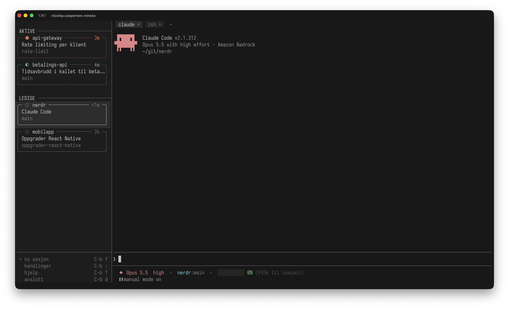

# nerdr

nerdr gir deg oversikt over Claude Code-sesjonene dine i tmux. Du ser hvilke
Claude-er som spør om noe og hvilke som er ferdige, og går inn i den du vil.
nerdr bygger på tmux og har ingen egen server. Den gjør ingen nettverkskall,
oppdaterer seg ikke selv og er én binær. Den virker bare med Claude Code, på
macOS og Linux.



## Forutsetninger

- [Claude Code](https://claude.com/claude-code)
- tmux (testet med 3.8), som installeringen tilbyr å installere
- macOS eller Linux

## Installere

```
curl -fsSL https://github.com/nicolayro/nerdr/releases/latest/download/installer.sh | sh
```

- nerdr legges i `~/opt/bin`, `~/bin` eller `~/.local/bin`, den første som
  finnes, eller der den ligger fra før.
- `NERDR_BIN=<mappe>` foran `sh` velger en annen mappe, og
  `NERDR_VERSJON=v0.1.0` en bestemt versjon.
- Mangler tmux, spør scriptet om det skal installere den med `brew`, `dnf`,
  `apt-get` eller `pacman`. `NERDR_TMUX=ja` eller `nei` svarer på
  forhånd.
- Kjør kommandoen på nytt for å oppdatere. nerdr oppdaterer seg ikke selv.

Du kan også be Claude om å installere og sette opp nerdr etter
[INSTALL.md](INSTALL.md).

## Kom i gang

1. Installer nerdr som over.
2. Kjør `nerdr` i en vanlig terminalfane, utenfor tmux.
3. Start en Claude med prefikset og `f`, eller «+ ny sesjon» nederst i lista,
   og velg en mappe. Du er inne i den nye Claude-en med en gang.
4. Prefikset og `w` tar deg tilbake til lista. Der blar du med piltastene og
   går inn i en Claude med `⏎`. Det som vises, byttes først da, og `esc` tar
   deg tilbake dit du var.
5. Prefikset og `?` viser hjelpen.

Prefikset er det samme som i tmux, `C-b` hvis du ikke har endret det.

## Bruk

Kjør `nerdr` i en vanlig terminalfane, utenfor tmux. Bare Claude som kjører i
tmux, vises. Har ikke tmux noen sesjon, lager nerdr en.

### Lista

Tastene går til Claude-en du er inne i. nerdr selv styrer du med knappene,
eller med prefikset og en tast, som i tmux. I lista er det bare disse:

| Tast | Hva |
| --- | --- |
| `↑` `↓` / `k` `j` | Velg Claude |
| `⏎` | Gå inn i Claude-en |
| `C-c` | Avslutt |

Andre bokstaver i lista gjør ingenting.

Hver Claude står i en boks, med tegnet, repoet og tiden i toppkanten, oppgaven
inni og branchen under. Et worktree står med navnet til repoet det er laget fra. Lista er delt i to:

| | |
| --- | --- |
| **aktive** | `●` spør om noe, `◆` er ferdig og venter på deg, `◐` jobber, `◌` starter |
| **ledige** | `○` er ferdig, og du har gått ut av den uten å sette den i gang igjen |

Den du er inne i, er aldri ledig. Kortet til den som vises, har en svak
bakgrunn, og i lista har kortet du står på, sterk bakgrunn og fet tekst.
Blant de aktive står den som sist ble aktiv, øverst, og blant de ledige den som
sist ble ferdig. Det står hvor lenge den har ventet, jobbet eller vært ferdig.
Får ikke lista plass, ruller den med musehjulet og følger kortet du står på.
Pilene øverst og nederst sier at det er flere over og under, og pila øverst er
oransje når noen over venter på deg. Et klikk på en pil ruller en side.

Nederst i lista står knappene «+ ny sesjon», «handlinger», «hjelp» og
«avslutt», hver med tasten etter prefikset som gjør det samme. I et lavt vindu og
på stripa står bare «+ ny sesjon» der. Claude-ene
kjører videre i tmux når nerdr avslutter, og er der neste gang du starter
nerdr. `tmux kill-server` stopper tmux og alt som kjører i det.

«handlinger», eller prefikset og `:`, viser alt nerdr kan gjøre, med tasten ved siden av, og du søker fram det du vil og trykker `⏎`.
Valgene i konfigurasjonen står der også, som «mye farge» og «skjul tiden».

Dra i streken mellom lista og panen for å gjøre lista bredere eller smalere.
Drar du den helt inn, blir lista en stripe med bare tegnene, og et dobbeltklikk
på streken bytter mellom stripa og bredden du hadde. Bredden står i den globale
tmux-optionen `@nerdr-liste`, så den er den samme neste gang.

Når du sist var inne i en Claude, skriver nerdr i pane-optionen `@nerdr-sett`
i tmux. Den forsvinner med panen, og det en Claude blir ferdig med mens nerdr
er lukket, venter på deg neste gang.

### Musen

Et klikk på en Claude i lista går inn i den. Et klikk i panen går også inn, og
et klikk i lista utenfor kortene tar deg ut igjen. Står musen
over et kort, kommer `×` der tiden står. Den lukker sesjonen til Claude-en, med
det du har åpnet ved siden av, etter at du har svart. Kjører noe annet enn et
skall der, står det i spørsmålet. I en sesjon nerdr ikke har laget, lukkes bare
vinduet, og deler flere Claude-er vinduet, bare panen. Klikk og
musehjul i sesjonen går videre når programmet der har slått på mus, som Claude
Code i fullskjerm. Ellers ruller hjulet i historikken, og en tast tar deg
tilbake til bunnen. Det du drar over, kopieres når du slipper, med `pbcopy`,
`wl-copy`, `xclip` eller `xsel`. I `less` og `man` blir hjulet til piltaster.
I handlingene, i popupen for ny sesjon og i konfigurasjonen kjører eller
velger et klikk det du klikker på, hjulet blar, og et klikk utenfor lukker.

### Panen og vinduene

Er vinduet delt i flere paner, viser nerdr dem der tmux har plassert dem, i
hver sin boks eller med streker mellom. Tastene går til den aktive panen, og et klikk gjør en annen pane aktiv. En
terminal ved siden av Claude-en får du ved å dele vinduet eller lage et nytt.
Øverst står vinduene i sesjonen som faner med bakgrunn, og vinduet som vises,
har sterkere bakgrunn. Et klikk på en fane viser vinduet, og `×` i fanen
lukker det. Fra lista går du alltid inn i vinduet til Claude-en.

Med tmux 3.5 eller nyere får panene fargene terminalen hadde da nerdr startet,
så Claude Code med «Auto (match terminal)» i `/theme` blir lys eller mørk som
terminalen.

### Prefikset

Prefikset er det du setter i `NERDR_PREFIKS`, ellers det samme som i
tmux-oppsettet ditt, ellers `C-b`. Tastene etter det er de samme som i tmux, og
virker både fra lista og fra panen:

| Etter prefikset | Hva |
| --- | --- |
| `:` | Handlinger: alt nerdr kan gjøre, søkbart |
| `f` | Ny sesjon |
| `r` | Hent en tidligere samtale |
| `c` | Ny terminal, i mappa til panen |
| `n` `p` | Neste og forrige vindu |
| `0`–`9` | Vinduet med det nummeret |
| `l` | Siste vindu, det du var i før |
| `&` | Lukk vindu |
| `%` | Del side om side |
| `"` | Del over og under |
| `o` / `←` `↑` `↓` `→` | Neste pane, eller panen i den retningen |
| `;` | Siste pane, den som var aktiv før |
| `z` | Zoom pane, inn og ut |
| `x` | Lukk pane |
| `{` `}` | Flytt pane bakover og framover |
| `Space` | Neste oppsett |
| `C-o` | Roter paner |
| `C-←` `C-↑` `C-↓` `C-→` | Endre størrelsen, med `M-` fem om gangen |
| `PgUp` | Rull en side opp |
| `(` `)` | Forrige og neste sesjon |
| `b` | Konfigurasjon |
| `w` `s` | Tilbake til lista |
| `d` | Avslutt |
| `?` | Hjelp |
| prefikset | Send prefikset til panen |

Bindingene etter prefikset i `.tmux.conf` gjelder også i nerdr, som
`bind | split-window -h`, og tastene med `-r` kan trykkes igjen uten
prefikset. Kommandoer som trenger et skjermbilde fra tmux, som `display-popup`,
`command-prompt` og `copy-mode`, virker ikke, og da gjør tasten det den gjør i
nerdr. `f`, `r`, `w`, `s`, `b`, `d`, `?`, `:`, `(` og `)` er alltid nerdr sine.
Hjelpen og handlingene viser tastene du har bundet. nerdr leser bindingene når
den starter.

### Starte og fortsette

«+ ny sesjon» nederst i lista, eller prefikset og `f`, åpner en popup der du
søker fram en mappe, og `⏎` starter `claude`
der i en ny tmux-sesjon med samme navn som mappa. Finnes sesjonen, får den nye
et nummer etter navnet, som `nerdr-2`, så vinduene du lager ved siden av en
Claude, hører til den. Lista er tom til du skriver. Velgeren søker i mappene
du har brukt Claude i, og i alle mappene under `NERDR_MAPPER`, som er `~` om
du ikke har satt den. Ved like gode treff står mappene du har brukt, først. I
et git-repo er bare repoet og prosjektene i det med, inntil fire nivåer ned,
som appene i et monorepo. Et prosjekt er en mappe med
`package.json`, `pom.xml`, `build.gradle`, `Cargo.toml`, `go.mod`,
`pyproject.toml` eller `deno.json`. Skjulte mapper, `node_modules`, `target`,
`build`, testmapper og `~/Library` er ikke med. Mappene leses på nytt hver gang
velgeren åpnes, så en mappe du nettopp har laget, er med. Til alle er lest,
står det `…` etter antallet.

Avslutter Claude-en i en sesjon nerdr har laget, lukkes sesjonen etter ti
sekunder når det bare står skall igjen i den. Kjører noe annet der, som `nvim`,
står sesjonen i lista som «uten Claude» med programmene, til du lukker den med
`×`. Sesjoner du har laget selv, rører ikke nerdr.

Prefikset og `r`, eller «hent samtale» under handlingene, viser de siste samtalene dine med mappe, tittel og alder, og `⏎`
fortsetter den du velger, i mappa den hørte til. Samtaler som kjører, står ikke
der. `C-r` i popupen bytter mellom samtalene og mappene.

I begge tilfeller er du inne i den nye Claude-en med en gang.

## Kommandoer

For script og agenter, ved siden av TUI-et. Med `--json` kommer svaret som JSON
med et `versjon`-felt.

| | |
| --- | --- |
| `nerdr liste` | Claude-ene i tmux, gruppert som i TUI-et, med pane, mappe, repo, branch og oppgave |
| `nerdr samtaler` | Tidligere samtaler, nyest først, med id, mappe og tittel |
| `nerdr ny <mappe>` | Start en Claude i mappa, som «+ ny sesjon» |
| `nerdr ny --fortsett <id>` | Fortsett en samtale i mappa den hørte til, som «hent samtale» |
| `nerdr forklar` | Hvordan nerdr brukes, skrevet for en agent som skal forklare det eller gjøre noe for deg. `nerdr --help` viser til den. |

I JSON fra `liste` er `tilstand` det Claude melder selv (`venter`, `jobber`
eller `klar`), eller `null` når nerdr ikke kjenner statusen. `merke` er det lista viser (`spør`, `ulest`, `jobber` eller
`sett`), og `gruppe` er `venter` for `spør` og `ulest`, `jobber` for `jobber`
og `ferdig` for `sett`.
`sett` er da du sist var inne i Claude-en i nerdr, i millisekunder som
`endret`, eller `null` når nerdr ikke har sett den.

## Konfigurasjon

Prefikset og `b` åpner konfigurasjonen. Et klikk på en verdi velger den, og
valget gjelder med en gang. tmux husker det i `@nerdr-utseende`. Et valg som
bare gjelder for valget over, står rett under det, og er borte når det
ikke gjelder.

| | |
| --- | --- |
| **ramme** | `bokser` gir hver pane en boks med avrundede hjørner og luft mellom, også når vinduet har én pane. `linjer` lar panene fylle visningen med streker mellom, som i tmux. |
| **farge** | `på` gir tegnene og tiden fargen til gruppen, og rammene en tone av den. `av` har ingen farge. |
| **ulest** | Fargen til det som er ferdig og ikke sett. `oransje` er som det som spør, og `blå` skiller dem. Bare med farge. |
| **kortdesign** | `vanlig` har en boks for hver Claude. `minimal` har én linje for hver, med tegnet, oppgaven og tiden. |
| **oppgave** | Hvor mange linjer oppgaven får i boksen, fra `1` til `3`. Bare med `vanlig`. |
| **mappe** | `på` viser mappa under branchen når Claude-en ikke jobber i mappa til repoet: hele stien til et worktree, eller undermappa i repoet. Bare med `vanlig`. |
| **sortering** | `prioritert` deler lista i aktive og ledige. `prosjekt` har en gruppe for hvert repo, og både repoene og Claude-ene i dem står i den rekkefølgen de ble startet. `←` og `→`, eller `h` og `l`, bretter repoet sammen og ut. `aktivitet` har ingen grupper, og den som sist endret tilstand, står øverst. Et klikk på sorteringen øverst til høyre i lista bytter til neste. |
| **overskrift** | Navnet på repoet over Claude-ene, uten stien, så det stemmer også for et worktree: på en `rad` med bakgrunn, eller med en `strek` bort til skillelinja. Bare med `prosjekt`. |
| **ledige** | Om de ledige står rett `under` de aktive, eller begynner på `midten` av lista, så de ikke flytter seg når en blir aktiv. Bare med `prioritert`. |

Standard er linjer mellom panene, farge på med ulest i oransje, vanlig
kortdesign, én linje til oppgaven, mappa i kortet, og sortert prioritert med de
ledige under.
Sortert etter prosjekt har repoet en strek. `nerdr liste` er alltid sortert
prioritert. I `@nerdr-utseende` står valgene med navnene de hadde først:
`paner`, `farge`, `plass`, `tittel`, `orden` med `nerdr`, `mappe` og
`aktivitet`, `ledig`, `topp` for overskriften og `sti` for mappa.

## Innstillinger

| | |
| --- | --- |
| `NERDR_MAPPER` | Mappene mappevelgeren søker under, i tillegg til dem du har brukt Claude i. Kolonseparert, som `~/git:~/kode`. Standard er `~`. |
| `NERDR_PREFIKS` | Prefikset, skrevet som i tmux: `C-a`, `M-a` eller `C-Space`. Standard er prefikset i tmux-oppsettet ditt, ellers `C-b`. Det endrer ikke tmux, bare nerdr. |
| `CLAUDE_CONFIG_DIR` | Katalogen til Claude Code, som for Claude Code selv. Standard er `~/.claude`. |
| `nerdr -L <socket>` | tmux-serveren, som `tmux -L`. |

## Avinstallere

```
curl -fsSL https://github.com/nicolayro/nerdr/releases/latest/download/avinstaller.sh | sh
```

nerdr lagrer ingenting annet enn seg selv. Har du satt `NERDR_MAPPER`, kan linja
fjernes fra skallets oppstartsfil.

## Bygge fra kildekoden

Krever Rust 1.85 eller nyere.

```
cargo install --locked --git https://github.com/nicolayro/nerdr nerdr
```

nerdr havner i `~/.cargo/bin`, og fjernes med `cargo uninstall nerdr`.

## Utvikle

- `cargo run` starter nerdr.
- `scripts/tui-test.sh` kjører nerdr mot en falsk Claude på egne tmux-servere.
- `scripts/installer-test.sh` kjører installeringen og avinstalleringen mot en
  release i en lokal mappe og et falskt `HOME`.
- En tag som `v1.0.0` får `.github/workflows/release.yml` til å bygge binærene
  og legge dem i en release.
